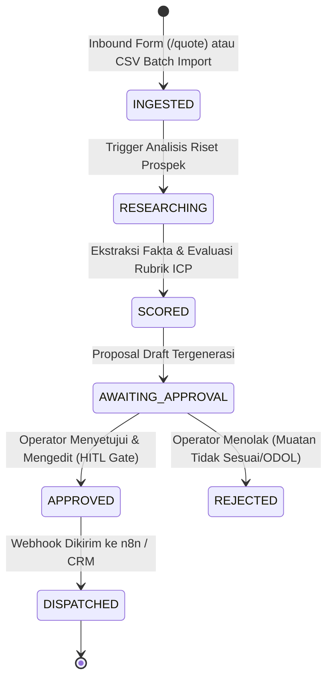

# PT Trukindo Logistik Prima — AstraOps Platform
### Platform Manajemen Komersial Logistik Darat B2B & Otomasi Intelijen Prospek FTL

[](https://github.com/dannyportfolio/PT-Trukindo-Logistik-Prima/actions)
[](https://nextjs.org/)
[](https://www.typescriptlang.org/)
[](https://www.postgresql.org/)
[](https://www.docker.com/)

---

## 📌 1. Latar Belakang & Profil Bisnis Perusahaan

**PT Trukindo Logistik Prima** adalah perusahaan jasa transportasi darat komersial Business-to-Business (B2B) yang beroperasi di Indonesia. Perusahaan mengkhususkan diri pada penyediaan layanan:
1. **Full Truckload (FTL) Charter:** Pengangkutan carter penuh titik-ke-titik (*point-to-point*) tanpa konsolidasi muatan pihak ketiga, menjamin kecepatan waktu transit dan keutuhan segel kargo dari gudang pengirim ke gudang penerima.
2. **Scheduled Linehaul:** Jadwal keberangkatan reguler antarkota berdisiplin tinggi di sepanjang koridor arteri industri utama.
3. **Dedicated Contract Logistics:** Alokasi armada dan pengemudi terdedikasi jangka panjang untuk korporasi FMCG, manufaktur otomotif/elektronik, dan ritel skala besar.

### Koridor Layanan Utama
- **Trans-Jawa & Pantura:** Menghubungkan pusat manufaktur Jabodetabek, Cikarang, Karawang (KIIC/Suryacipta) ke Semarang, Solo, Surabaya, dan Pelabuhan Tanjung Perak.
- **Lintas Jawa — Bali:** Distribusi barang konsumsi via penyeberangan Ketapang – Gilimanuk hingga Denpasar.
- **Lintas Jawa — Sumatra:** Pengiriman linehaul via Merak – Bakauheni menuju Lampung, Palembang, hingga Medan.

### Komitmen Operasional & Integritas
- **Kepatuhan Batas Muatan (Zero ODOL):** Komitmen penuh terhadap regulasi batas tonase jalan nasional demi keselamatan pengemudi dan keutuhan sasis kendaraan.
- **Integritas Armada:** Menampilkan dokumentasi kendaraan komersial netral tanpa manipulasi klaim aset atau filter warna yang merusak realitas visual.
- **Peninjauan Komersial Berbasis Analisis Manusia:** Setiap penawaran harga dihitung berdasarkan karakteristik muatan riil, kesesuaian dimensi sasis truk, dan efisiensi rute.

---

## 🧭 2. Gambaran Gamblang Arah Business Logic Aplikasi

Platform **AstraOps** dirancang secara khusus untuk mengatasi kendala klasik logistik B2B: *inefisiensi penanganan penawaran harga, kebocoran data kontak, penumpukan inkuiri kargo tidak memenuhi syarat (unqualified leads), dan lambatnya pembuatan proposal komersial*.

Aplikasi ini beroperasi dengan **Dua Sisi Arsitektur Terintegrasi**:

```
┌─────────────────────────────────────────────────────────────────────────────┐
│                      PT TRUKINDO LOGISTIK PRIMA                             │
├──────────────────────────────────────┬──────────────────────────────────────┤
│       1. SISI PUBLIK (FRONT-DOOR)    │   2. SISI INTERNAL (BUSINESS DESK)   │
│   • Profil Perusahaan & Layanan FTL  │   • Ingestion & Database Transaksi   │
│   • Spesifikasi Armada & Kargo       │   • Web Scraper Sandboxed (SSRF)     │
│   • Skenario Logistik Antarkota      │   • Model Gateway AI (ICP Scoring)   │
│   • Formulir Penawaran Rute 3-Step   │   • Human-in-the-Loop (HITL) Gate    │
│   • Anti-Spam, Rate Limit, Idempotent│   • n8n Webhook Outbound Dispatch    │
└──────────────────────────────────────┴──────────────────────────────────────┘
```

---

## ⚙️ 3. Alur Logika Bisnis & Siklus Hidup Prospek (Lifecycle FSM)

Setiap permintaan penawaran komersial yang masuk diproses melalui mesin status deterministik (*Finite State Machine*) berlandaskan transaksi atomik PostgreSQL:



### Tahapan Logika Bisnis:

#### 1. Ingestion & Proteksi Garis Depan (`POST /api/inquiries`)
- **Sliding-Window IP Rate Limiting:** Maksimal 5 pengiriman formulir per jam per alamat IP untuk mencegah penyerangan brute-force/DDoS.
- **Bot Honeypot Defense:** Field perangkap tak terlihat; jika bot otomatis mengisi field ini, request langsung ditolak dengan kode `422 BOT_DETECTED`.
- **Minimum Human Interaction Time:** Waktu dari render formulir hingga klik tombol kirim wajib $\ge 3$ detik. Pengisian instan oleh skrip ditolak (`422 SUBMISSION_TOO_FAST`).
- **PostgreSQL Idempotency Lock:** Menggunakan header `Idempotency-Key` dengan hashing SHA-256 payload untuk mencegah duplikasi pesanan armada akibat koneksi ganda atau klik berulang klien.
- **Penyimpanan Transaksional Atomik:** Inkuiri masuk langsung disimpan ke tabel `leads` dan dicatat ke `audit_logs` dengan status awal `INGESTED`. Klien langsung menerima kode referensi resmi unik (format: `TRK-XXXXXXXX`).

#### 2. Riset Perusahaan & Web Scraping Terisolasi (`src/lib/scraper.ts`)
- Operator internal dapat memicu riset otomatis terhadap calon mitra industri.
- Sistem mengekstrak profil perusahaan prospek dari situs web publik mereka menggunakan `cheerio`.
- **SSRF & DNS-Rebinding Defense:** Sistem divalidasi oleh `ipaddr.js` untuk memblokir IP privat (RFC 1918), loopback (`127.0.0.1`), metadata cloud AWS (`169.254.169.254`), dan domain berbahaya.

#### 3. Evaluasi Kualifikasi ICP Logistik (`src/lib/scorer.ts`)
Setiap prospek dievaluasi terhadap rubrik kualifikasi logistik B2B (*Ideal Customer Profile*):
- **FTL Cargo Fit:** Apakah jenis kargo membutuhkan angkutan carter truk penuh (FMCG, bahan baku, manufaktur) vs retail e-commerce eceran?
- **Kesesuaian Rute:** Apakah asal-tujuan pengiriman berada di koridor Trans-Jawa, Bali, atau Sumatra?
- **Skor Kualifikasi (0–100):**
  - **Tier 1 (Skor 80–100):** *High Fit Enterprise* — Rekomendasi kontrak dedicated jangka panjang.
  - **Tier 2 (Skor 60–79):** *Mid-Market Regular* — Rekomendasi FTL terjadwal.
  - **Tier 3 (Skor < 60):** *Disqualified* — Muatan berbahaya non-izin, kargo eceran, atau risiko ODOL.

#### 4. Gerbang Tinjauan Manusia (Human-in-the-Loop / HITL Gate)
- **Aturan Tegas:** Proposal harga dan perjanjian komersial **TIDAK PERNAH dikirim secara otomatis**.
- State machine berhenti pada status `AWAITING_APPROVAL`.
- Sales Operator / SDR Trukindo memeriksa ringkasan analisis, memvalidasi ketersediaan kapasitas armada di depo asal, dan dapat mengedit klausul draft penawaran.
- Operator memiliki kuasa penuh untuk menekan **"Approve & Qualify"** atau **"Reject / Insufficient"**.

#### 5. Audit Immutability & Dispatching
- Setiap perubahan status dicatat ke tabel `audit_logs` yang diproteksi trigger database `enforce_audit_immutability` (data riwayat audit tidak dapat diedit atau dihapus oleh siapapun).
- Setelah disetujui, event `APPROVED` memicu integrasi webhook n8n berotentikasi HMAC-SHA256 untuk pengiriman penawaran resmi via email dan sinkronisasi ke sistem ERP/CRM Trukindo.

---

## 🎨 4. Sistem Desain: Trukindo Blue & White Corporate

Platform menggunakan identitas visual **Blue & White Corporate** yang bersih, berwibawa, dan kontras tinggi untuk segmen enterprise B2B:

| Token Warna | Nilai Hex | Peruntukan Fungsional |
| :--- | :---: | :--- |
| **Corporate Blue** | `#123B70` | Identitas brand, logo, navigasi, dan heading pendukung |
| **Deep Blue** | `#0B2D52` | Background footer, utility topbar, dan judul utama hero |
| **Interactive Blue** | `#1D5FA7` | Tombol CTA primer ("Minta Penawaran"), link aktif, progress bar |
| **Bright Blue** | `#2F80D1` | Hover state kartu interaktif, highlight elemen |
| **Pale Blue** | `#EAF3FF` | Kartu armada/servis terpilih (*selected state*), info callout |
| **Main White** | `#FFFFFF` | Permukaan kartu utama, modal dialog, formulir input |
| **Soft White** | `#F7FAFE` | Background kanvas seluruh halaman publik |
| **Light Blue Gray** | `#EEF3F9` | Secondary container, header tabel kapasitas armada |
| **Border Divider** | `#D7E2EF` | Garis pemisah kartu, border input form |
| **Semantic Success**| `#15803D` | Kepatuhan batas muatan Zero ODOL, langkah form selesai |
| **Semantic Warning**| `#B45309` | Indikator peringatan dan tinjauan manual |
| **Semantic Error**  | `#B91C1C` | Tanda wajib asteris (`*`), validasi input gagal |

---

## 🏗️ 5. Struktur Arsitektur Direktori Repository

```
AstraOPS/
├── .github/workflows/       # Pipeline CI/CD otomatis (Typecheck, Lint, Test, Build)
├── docs/                    # Dokumentasi arsitektur, rubrik ICP, deployment, & roadmap
│   ├── DEPLOYMENT.md        # Panduan deployment produksi, container, DNS, & HTTPS
│   ├── ROADMAP.md           # Tahapan rilis (Phases 1-4) & GitHub Milestones
│   └── architecture.md      # Spesifikasi arsitektur C4 Level 1-2 & ADR
├── migrations/              # Berkas migrasi database transaksional PostgreSQL
│   ├── 001_create_leads_and_audit.sql
│   ├── 002_create_idempotency_keys.sql
│   ├── 003_create_agent_runs_and_research.sql
│   └── 004_add_inbound_inquiries_and_sources.sql
├── scripts/                 # Script devops, init SQL, dan runner migrasi mandiri
│   ├── init-postgres.sql    # Inisialisasi role database astraops_app
│   └── migrate.mjs          # Runner migrasi dengan PostgreSQL advisory lock
├── src/
│   ├── app/                 # Next.js App Router (Halaman Publik & Dynamic API Routes)
│   │   ├── (public)/        # Beranda, /about, /services, /fleet-cargo, /industries, /quote
│   │   ├── api/inquiries/   # Endpoint publik penerima penawaran (CORS & rate limited)
│   │   ├── api/leads/       # Manajemen leads & batch CSV import
│   │   ├── api/auth/        # Manajemen sesi login operator internal
│   │   └── leads/           # Dashboard internal Business Desk & review inkuiri
│   ├── components/          # Komponen UI modular (PublicNavbar, QuoteRequestForm, Footer)
│   ├── lib/                 # Core business logic: db pool, auth, scraper, scorer, migrator
│   └── types/               # TypeScript interfaces & Zod validation schemas
├── Dockerfile               # Multi-stage production container build (Standalone output)
├── docker-compose.yml       # Orkestrasi container App + PostgreSQL 16
└── package.json             # Manifest dependensi & script runner
```

---

## 🚀 6. Panduan Menjalankan Secara Lokal

### Prasyarat
- Node.js versi 20.x atau 24.x
- Docker & Docker Compose (opsional untuk container database)
- PostgreSQL 16

### Langkah Instalasi
1. **Clone repository:**
   ```bash
   git clone https://github.com/dannyportfolio/PT-Trukindo-Logistik-Prima.git
   cd PT-Trukindo-Logistik-Prima
   ```

2. **Pasang dependensi:**
   ```bash
   npm install
   ```

3. **Konfigurasi Environment Variables:**
   ```bash
   cp .env.example .env.local
   # Sesuaikan DATABASE_URL jika menggunakan PostgreSQL lokal
   ```

4. **Jalankan Migrasi Database:**
   ```bash
   npm run db:migrate
   ```

5. **Jalankan Server Development:**
   ```bash
   npm run dev
   ```
   Aplikasi publik akan aktif di `http://localhost:3000`, dan halaman penawaran di `http://localhost:3000/quote`.

---

## 🧪 7. Perintah Pengujian & Verifikasi

Repository ini mematuhi standar *Zero-Tolerance Regression*:

```bash
# 1. Pengecekan Validitas Tipe TypeScript
npm run typecheck

# 2. Pengecekan Standar Koding ESLint
npm run lint

# 3. Menjalankan Seluruh Unit Test Suite (354 Tests)
npm test

# 4. Uji Kompilasi Bundle Produksi
npm run build
```

---

## 🗺️ 8. Roadmap & Tahapan Rilis (Phases)

Pengembangan platform dikelola melalui **[GitHub Milestones](https://github.com/dannyportfolio/PT-Trukindo-Logistik-Prima/milestones)**:

- **[Phase 1: Production Foundation & Live Deployment](https://github.com/dannyportfolio/PT-Trukindo-Logistik-Prima/milestone/1) (Target: Nov 2026):**
  Peluncuran container di VPS Ubuntu, custom domain dengan reverse proxy Caddy HTTPS otomatis, dan database managed PostgreSQL. *(Issues: [#1](https://github.com/dannyportfolio/PT-Trukindo-Logistik-Prima/issues/1), [#3](https://github.com/dannyportfolio/PT-Trukindo-Logistik-Prima/issues/3))*.
- **[Phase 2: Commercial Intake & Communication Automation](https://github.com/dannyportfolio/PT-Trukindo-Logistik-Prima/milestone/2) (Target: Nov 2026):**
  Otomasi email tanda terima klien (`TRK-XXXX`), WhatsApp alert tim sales, dan peningkatan login RBAC & MFA. *(Issues: [#2](https://github.com/dannyportfolio/PT-Trukindo-Logistik-Prima/issues/2), [#4](https://github.com/dannyportfolio/PT-Trukindo-Logistik-Prima/issues/4))*.
- **[Phase 3: AI Intelligence Engine & ICP Prospecting](https://github.com/dannyportfolio/PT-Trukindo-Logistik-Prima/milestone/3) (Target: Des 2026):**
  Aktivasi 9Router Gateway, web scraping sandboxed, evaluasi rubrik ICP kargo logistik, dan gate persetujuan proposal penawaran (HITL). *(Issue: [#5](https://github.com/dannyportfolio/PT-Trukindo-Logistik-Prima/issues/5))*.
- **[Phase 4: Fleet Telematics & Real-Time Client Tracking](https://github.com/dannyportfolio/PT-Trukindo-Logistik-Prima/milestone/4) (Target: Jan 2027):**
  Portal publik cek status Surat Jalan / Waybill (`/track`) dan integrasi data sensor GPS armada logistik antarkota. *(Issue: [#6](https://github.com/dannyportfolio/PT-Trukindo-Logistik-Prima/issues/6))*.

Rincian lengkap deployment dan operasional dapat dibaca pada [docs/DEPLOYMENT.md](file:///c:/Users/Lenovo%20X13/Documents/AstraOPS/docs/DEPLOYMENT.md) dan [docs/ROADMAP.md](file:///c:/Users/Lenovo%20X13/Documents/AstraOPS/docs/ROADMAP.md).

---

## 📄 9. Lisensi & Hak Cipta
Hak Cipta © 2026 **PT Trukindo Logistik Prima**. Seluruh hak cipta dilindungi undang-undang.
